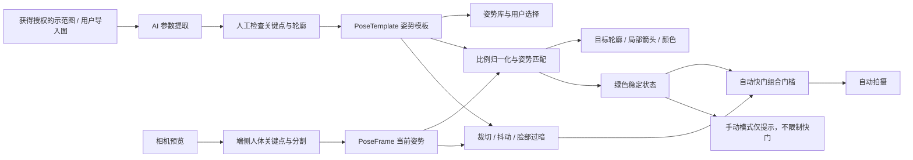

# Posey 技术方案（历史版本）

> 本文记录早期检测与自动拍摄方案。当前产品已移除姿势检测、语音提醒、自动拍摄和体验演示，现行功能以项目 README 为准。

## 1. 产品原则

Posey 不负责判断姿势是否“正确”或“好看”。用户先选择自己喜欢的示范姿势，系统只完成以下闭环：

1. 把示范图片转成可复用的姿势参数。
2. 在相机里叠加适配当前被拍者的引导轮廓。
3. 判断当前姿势与模板是否大致接近。
4. 接近时轮廓变绿；自动模式拍照，手动模式继续由用户决定快门。

系统可以检查失焦、闭眼、过暗、手机抖动和人体是否被裁掉，但这些属于拍摄质量检查，不能被包装成“AI 判断姿势好不好”。

### 调研依据与结论边界

截至 2026-08-24，当前仓库记录 2194 篇按 note id 去重的候选、290 篇逐帖深读和 194 个去重姿势家族；其中 104 个只有排除证据。6 个家族达到“至少 5 帖、3 位稳定创作者”来源准入：`hand-near-hair-or-forehead`（6 帖 / 5 创作者）、`crossed-arms-standing`（7 / 5）、`back-facing-arms-open`（9 / 8）、`side-lean-arms-open`（5 / 5）、`wall-lean-body-side-one-hand-pocket`（5 / 5）和 `standing-look-back-one-hand-pocket`（5 / 5）。六者均已有 Posey 自有抽象 33 点参数草案并接入 App；研究截图仍只作证据，不进入产品资源。草案状态保持 `needs-review`，不能描述成真人 / 真机标定已通过。数字以 `candidate-pool.json`、`deep-read.json`、`pose-families.json` 和 `npm run verify:research` 为准。

`scripts/plan-research-queue.mjs` 仍可生成研究候选队列，当前为 20 篇、覆盖 2 个近准入家族。但 3000 去重候选 / 800 深读不再是本次五天交付的阻塞目标，本轮停止扩量，优先完成产品实现和可重复校验。

调研支持的是“跨作者反复出现的动作关系”，不是客观审美结论。首版吸收六个可解释、可检测的来源准入关系；其中“插兜”只用腕部靠近髋部近似，“回头”只用头部与肩髋关系近似。光线和构图独立提示；体型评价、显瘦显高承诺、情侣双人动作和动态连拍不进入单人静态匹配。

## 2. 核心用户流程

1. 打开姿势库，按全身、半身、坐姿、街景、海边、夜景等条件筛选。
2. 选择一张示范图，并决定使用原方向还是左右镜像。
3. 进入相机，屏幕显示半透明目标轮廓和少量关键点。
4. 摄影者移动手机，被拍者调整动作；系统只提示当前差异最大且最容易改的一处。
5. 轮廓颜色从白色变成黄色，再变成绿色。
6. 自动模式：持续变绿一小段时间后倒计时拍摄；手动模式：快门一直可用，绿色只代表“已经大致对上”。
7. 拍完保留原图，并记录所用姿势模板，方便同一姿势重拍。

## 3. 用户听得懂的提示语言

### 允许使用

- “左手再高一点。”
- “右手靠近脸一点。”
- “两脚再分开一点。”
- “身体再侧一点。”
- “人往后一点。”
- “手机往下一点。”
- “脸有点暗，朝亮的地方转一点。”

### 禁止使用

- “顺时针转 30 度。”
- “移动到右侧三分线。”
- “俯仰角降低 8 度。”
- “肩髋比不符合标准。”
- “当前姿势只有 72 分。”

提示生成规则：

- 一次只说一件事，并同时高亮对应身体部位或显示箭头。
- 不说角度、厘米、顺逆时针和摄影术语。
- 只描述“怎么更接近模板”，不评价身体或审美。
- 如果一句话超过 14 个汉字，优先改成画面箭头或拆成下一步。
- 连续两次没有改善就暂停语音，只保留视觉提示。

## 4. 总体架构

## 5. 示范图片如何变成姿势参数

### 5.1 素材进入姿势库之前

每张候选示范图保留来源平台、原帖链接、作者、抓取日期和使用权限。小红书截图只能用于内部调研；正式 App 不得直接展示、裁剪或打包未经许可的博主图片。

可正式使用的来源只有：

- 与博主取得明确授权；
- 购买带移动应用分发权的素材；
- 自己重新拍摄示范图；
- 用户在自己的设备上导入其有权使用的图片。

### 5.2 AI 参数提取

对每张图片执行：

1. 找出主人物并生成分割蒙版。
2. 提取头、肩、肘、腕、髋、膝、踝等人体关键点。
3. 以髋部中心为原点，以躯干长度和肩宽为尺度做归一化。
4. 保存关节角度、四肢方向、手与脸 / 腰的相对位置、双脚距离等关系。
5. 提取低精度外轮廓，只用于屏幕引导，不把衣服宽窄或身体外形作为主要匹配条件。
6. 自动生成左右镜像版本。
7. 标记无法可靠看见的关节；看不见的部位不参与强制匹配。
8. 由人检查关键点是否落在正确部位，再发布为模板。

AI 在这里做的是“读图并转成参数”，不是判断博主的姿势是否合理。

## 6. “大致符合”如何判断

### 6.1 先适配不同身材

不能直接比较两个人的照片像素。匹配前先把模板骨架映射到当前被拍者的肩宽、躯干长度和腿长，再比较动作。这样不同身高、体型和衣服的人都可以复刻同一个姿势。

### 6.2 匹配内容

首版使用四组可解释指标：

| 指标 | 建议权重 | 说明 |
| --- | ---: | --- |
| 主要关节位置 | 55% | 肩、肘、腕、髋、膝、踝相对目标的位置 |
| 四肢方向与弯曲 | 25% | 手臂、腿和身体朝向是否接近 |
| 关键关系 | 15% | 例如右手是否靠近脸、两脚是否交叉、双手是否靠近 |
| 粗略轮廓 | 5% | 只辅助稳定显示，不用它要求身体外形相同 |

如果模板明确要求“手托脸”，手与脸的关系属于必须满足项；即使其他关节很接近，关系没有满足也不能直接变绿。

### 6.3 三档容差

- 宽松：主要动作相同即可，适合第一次使用。
- 标准：主要关节和关键关系都接近，作为默认档。
- 精准：更贴近模板，用于复拍同一画面。

初始阈值可设为宽松 72、标准 82、精准 90，但分数只供内部计算，用户不看到数字。实际阈值必须用真机测试校准。

### 6.4 颜色状态

- 白色：刚识别到人体，或距离模板还比较远。
- 黄色：主体动作已经接近，只剩一两处需要调整。
- 绿色：达到所选容差，并且关键关节连续稳定至少 600 ms。
- 灰色局部：该部位被挡住或看不清，不强行提示。

姿势匹配所需的关键点置信度不足时不能变绿，因为此时无法证明动作接近；但“人物是否被画面切掉”由独立的画面质量门槛判断。即使姿势已经绿色，裁切、抖动或脸部过暗仍可暂缓自动快门，但不能把绿色改成黄色或白色。

模板本身也可以把被衣服遮住的关节标为低置信度。例如半身和长裙参考图可以主动排除膝、踝；匹配器会同时检查当前画面和模板的可见度，避免用看不见的腿部阻塞绿色状态。

## 7. 自动拍摄与手动拍摄

### 自动模式

完整设计满足以下条件后进入短倒计时：

- 姿势轮廓连续变绿至少 600 ms；
- 模板要求的身体部位完整入镜；
- 手机连续稳定至少 300 ms；
- 脸部没有严重暗到看不清；
- 相机可用，且各门槛结果仍是最近 200 ms 内的新结果。

组合公式、每项判断的产品定义、信号来源、工程初值、未知状态、简单话术和真机标定方法完整定义在 [`05-画面质量门槛.md`](05-画面质量门槛.md)。倒计时过程中任一必需条件失效则取消，避免拍到调整中的瞬间。手动快门始终可用。

**当前实现边界：**生产代码已经实现人物裁切、背景稳定和脸部严重欠曝三项分析器，并与绿色稳定 600 ms、结果新鲜度 200 ms 组成自动快门门槛。抖动目前使用排除人物框后的 `32 × 48` 背景灰度帧差，是 WebView 可运行的交付近似；尚未接入光流、RANSAC 或陀螺仪。三项阈值尚未真人 / 真机标定，不能声称误判率或硬件验收达标。

走路、转圈和持续回头动作属于动态姿势，需要短时间轨迹与连拍挑帧，不进入当前 MVP。`standing-look-back-one-hand-pocket` 只匹配已经停住的回头终态，不识别转身过程。

### 手动模式

- 快门从始至终可按。
- 轮廓仍然显示白 / 黄 / 绿状态。
- 未变绿不弹窗阻止，也不说“姿势错误”。
- 可以关闭语音，只保留轮廓与局部箭头。

## 8. MVP 已实现技术选型

### 共享层

- React + TypeScript + Vite：姿势库、相机 HUD、结果页和本地数据。
- Capacitor：将同一套界面和端侧推理逻辑封装为 iOS / Android 工程。
- MediaPipe Pose Landmarker：浏览器、iOS WebView 和 Android WebView 共用 33 点人体模型；模型与 WASM 随包分发。
- SVG：绘制模板轮廓、当前骨架、局部高亮和方向箭头。
- LocalStorage：收藏和用户导入后的参数模板；不保存或上传实时视频帧。

### iOS

- Capacitor iOS 工程承载 WKWebView，相机使用 `getUserMedia`，并已配置相机与相册权限说明。
- MediaPipe 模型在设备内运行，不经过服务端。
- 后续若真机性能不足，再把视频采集迁到 AVFoundation，把关键点作为轻量数据送回共享层；不在 MVP 之前预先维护两套算法。

Apple 参考：[Detecting Human Body Poses in Images](https://developer.apple.com/documentation/vision/detecting-human-body-poses-in-images)。

### Android

- Capacitor Android 工程承载 WebView，相机使用 `getUserMedia`，Manifest 已声明相机权限。
- 分析最多约每 90 ms 取一帧，只保留最新结果，避免阻塞预览。
- 后续低端机优化可迁到 CameraX `ImageAnalysis`，但继续复用同一模板和匹配契约。

Google 参考：[Pose landmark detection guide](https://ai.google.dev/edge/mediapipe/solutions/vision/pose_landmarker)。

## 9. 性能目标

| 指标 | MVP 目标 |
| --- | --- |
| 相机预览 | 稳定 30 fps |
| 姿势分析 | 自适应 8–12 fps |
| 关键点结果端到端 P95 | ≤ 90 ms |
| 轮廓颜色和箭头响应 | ≤ 150 ms |
| 连续使用 | 20 分钟无崩溃、黑屏或不可恢复卡顿 |
| 默认网络依赖 | 无 |

设备发热时优先降低分割蒙版刷新率和分析帧率，不能让相机预览先卡住。

## 10. 数据与安全

- 实时相机帧默认只在设备上处理，不上传、不写入调试目录。
- 不做人脸身份识别，不建立未经被拍者同意的人脸或身体档案。
- 姿势模板必须记录来源和使用权限；没有授权的样本只能标记为 `research-only`。
- 对外展示的是自有或授权图片、抽象轮廓与参数，不能用“只保留骨架”规避原图授权问题。
- 用户可以删除自己导入的模板及其所有缓存。

## 11. 主要风险

| 风险 | 后果 | 改进方向 |
| --- | --- | --- |
| 严格匹配身体外形 | 不同体型用户很难变绿 | 以骨架和相对关系为主，轮廓权重保持很低 |
| 阈值太严格 | 用户一直调不对 | 默认宽松或标准，记录差异分布后校准阈值 |
| 阈值太松 | 明显不像也变绿 | 为手托脸、交叉腿等关键关系设置必须满足项 |
| 关键点抖动 | 颜色不断闪烁 | 时序滤波、600 ms 稳定门槛、迟滞区间 |
| 遮挡或长裙误判 | 错误提示腿部动作 | 低置信度部位变灰并退出强制匹配 |
| 提示难懂 | 用户不知道怎么做 | 禁用角度与术语，只说一个部位和一个方向 |
| 未授权使用博主图片 | 法律与平台风险 | 调研截图不入产品，建立授权和来源审核流程 |
